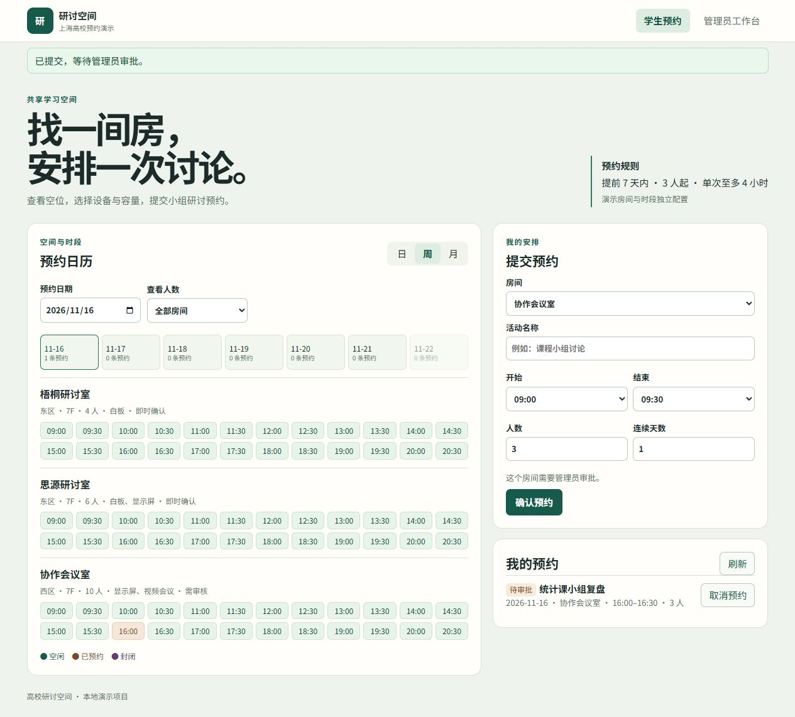
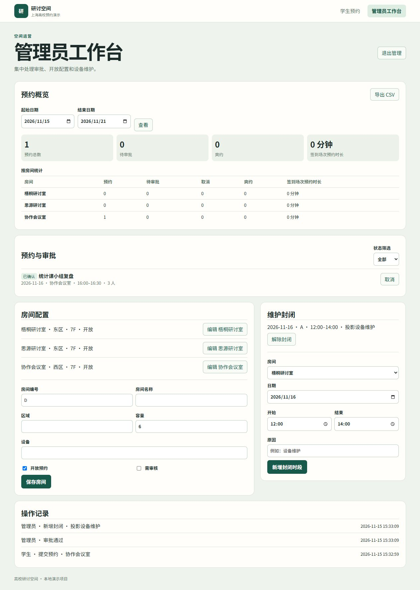

# 高校研讨空间预约

围绕高校小组讨论的预约流程做的本地系统：先按人数和设备找房间，再选择时段、申请和签到。学生能查到审批结果并取消预约；管理员处理审批、维修封闭和房间调整，查看预约记录与统计。场景取自上财图书馆公开规则，使用虚构房间演示。

[功能与规则](#功能与规则) · [本地运行](#本地运行) · [演示流程](#演示流程) · [系统设计](#系统设计) · [验证](#验证)



## 功能与规则

| 场景 | 已实现 |
| --- | --- |
| 找房间 | 日视图显示可预约、已预约、已过期和维修封闭时段。周视图、月视图显示各日预约数量，支持容量筛选和点击空档填入申请。 |
| 预约和审批 | 普通房间即时确认，需审批的房间占用时段直到审批、取消或超时。可在七天窗口内连续多日预约。整组逐日检查，任一天冲突则整组回滚。 |
| 签到和取消 | 学生可查看本浏览器预约和审批结果。预约开始前可取消，在开始前 10 分钟至开始后 15 分钟内可签到，未签到时释放剩余时段。 |
| 房间和维修 | 管理员可新增、修改和停用房间，设置区域、容量、设备与审批要求。封闭时段会与已有预约互斥。 |
| 运营报表 | 按日期筛选预约和维护计划，按房间查看预约、取消、爽约及签到场次的预约时长，并可导出 CSV。关键状态变化写入操作记录。 |

预约窗口、最低人数和单次时长参考[上财图书馆共享学习空间说明](https://lib.sufe.edu.cn/07/3d/c8286a132925/page.htm)。日历、房间配置与审批参考[开源 MRBS](https://meeting-room-booking-system.github.io/)。使用 FastAPI、SQLite 和原生网页实现本项目。房间、开放时间、签到容差及维护流程为演示设定，运行在本机，无需校方账号。

## 本地运行

使用 Python 3.12。在 Windows PowerShell 中执行：

```powershell
python -m venv .venv
.\.venv\Scripts\python.exe -m pip install -r requirements.txt
$env:ROOM_BOOKING_ADMIN_PASSWORD = '请改成你自己的本地演示口令'
.\.venv\Scripts\python.exe -m uvicorn app:create_app --factory --host 127.0.0.1 --port 8000
```

打开 [http://127.0.0.1:8000](http://127.0.0.1:8000)。进入管理员工作台时，输入启动前设置的口令。只体验学生预约时，可以省略设置口令。SQLite 文件默认在 `runtime/rooms.sqlite`，可用 `ROOM_BOOKING_DB` 指定路径。API 说明位于 [本地 /docs](http://127.0.0.1:8000/docs)。

## 演示流程

1. 在学生端选择明天。在周历里查看预约数量，选择协作会议室的一个空档，提交三人讨论预约。预约进入待审批状态。
2. 在同一浏览器切到管理员工作台，通过这条预约，并为另一间房添加一个维修时段。
3. 退出管理回到学生端。我的预约显示已确认，维修时段显示封闭。此时可以取消预约，并在时段日历核对释放结果。
4. 登录管理员端，按同一日期区间导出 CSV。预约状态和操作记录可用于核对汇总数据。



## 系统设计

两个处理选择对使用过程影响较大。需要审批的申请会先占用时段，否则管理员批准时可能已经被其他人预约；代价是待审批申请暂时占住资源，所以开始时仍未批准的申请会过期。连续多日预约采用全部成功或全部撤回，避免界面显示提交成功，实际只订到部分日期。

统计页保留取消、拒绝和爽约记录，便于解释房间空档的来源。“签到场次预约时长”只按计划时段累计，系统没有离场记录，不能用它计算真实使用率。

- **冲突判断**使用半开区间。占用时段 `[09:00, 09:30)` 允许下一条从 09:30 开始。容量限制、维修时段和全部重复日期在同一个 SQLite 写事务中检查，然后一次提交。
- **预约状态**跟踪待审批、已确认、已签到与已结束，也保留取消、拒绝、审批超时与爽约记录。查询和写操作会依照上海时间推进已到期状态，无需单独运行定时任务。
- **访问边界**使用本地会话区分学生与管理员。公共日历仅返回时段，不返回标题、预约凭证或学生会话。退出管理后可继续访问原学生会话。
- **报表口径**统计预约记录和状态。签到场次预约时长按计划时段计算，用于比较已签到预约的容量分布。
- **数据库兼容**首次启动会为旧库补齐状态、会话和管理表，原取消记录与第一版的预约凭证继续可用。

| 位置 | 职责 |
| --- | --- |
| `app.py` | 用户与管理接口、规则校验、CSV 导出 |
| `store.py` | SQLite 迁移、事务、状态推进和汇总 |
| `static/` | 学生预约、日历、管理员工作台 |
| `tests/` | 预约生命周期、事务冲突和兼容验证 |

运行范围为单机作品演示。登录采用本地会话和启动口令，房间与活动均为演示数据。

## 验证

```powershell
.\.venv\Scripts\python.exe -m pip install -r requirements-dev.txt
.\.venv\Scripts\python.exe -m pytest -q
```

测试覆盖并发抢占、审批权限、连续预约回滚、维修冲突、爽约释放与旧库迁移。浏览器验证覆盖提交审批、管理员通过、设定维修时段、返回学生端查看和取消。

